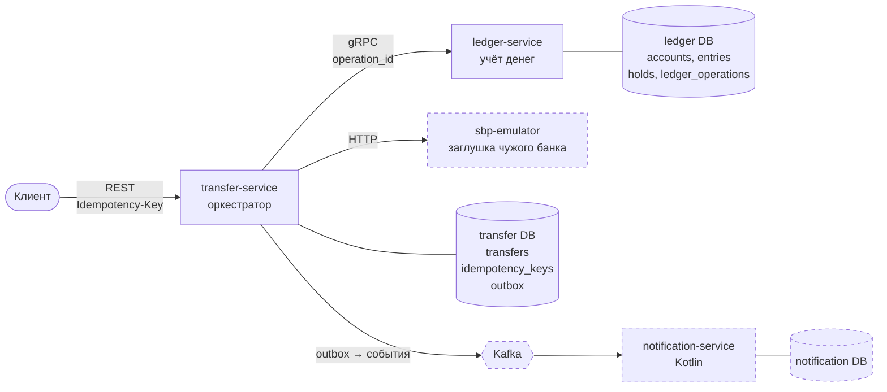
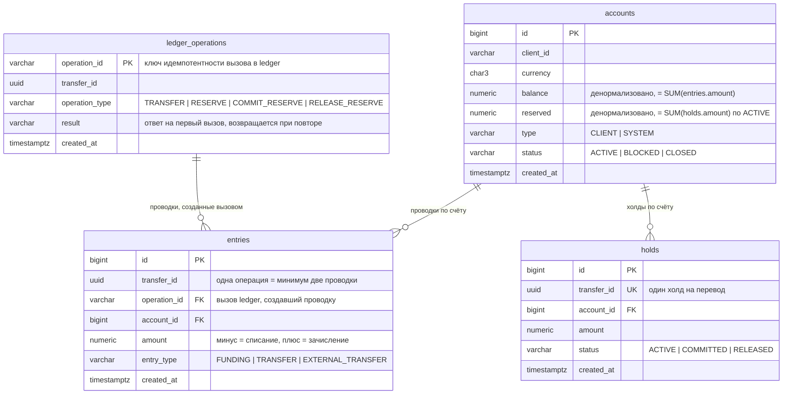
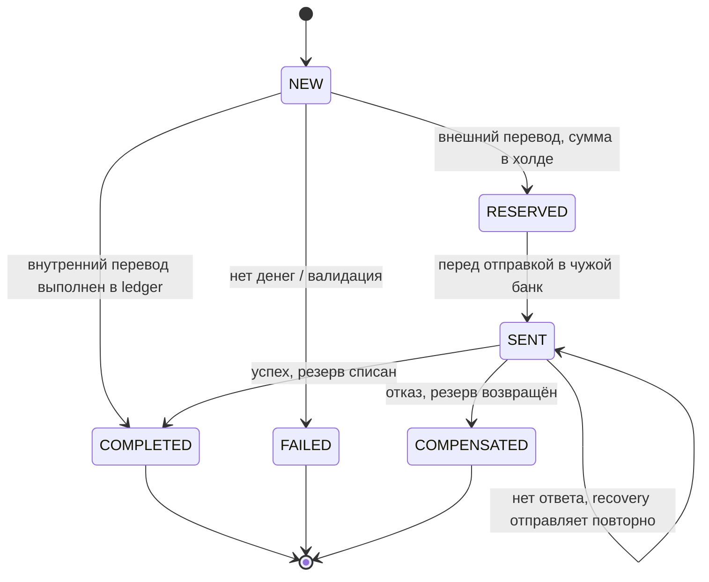
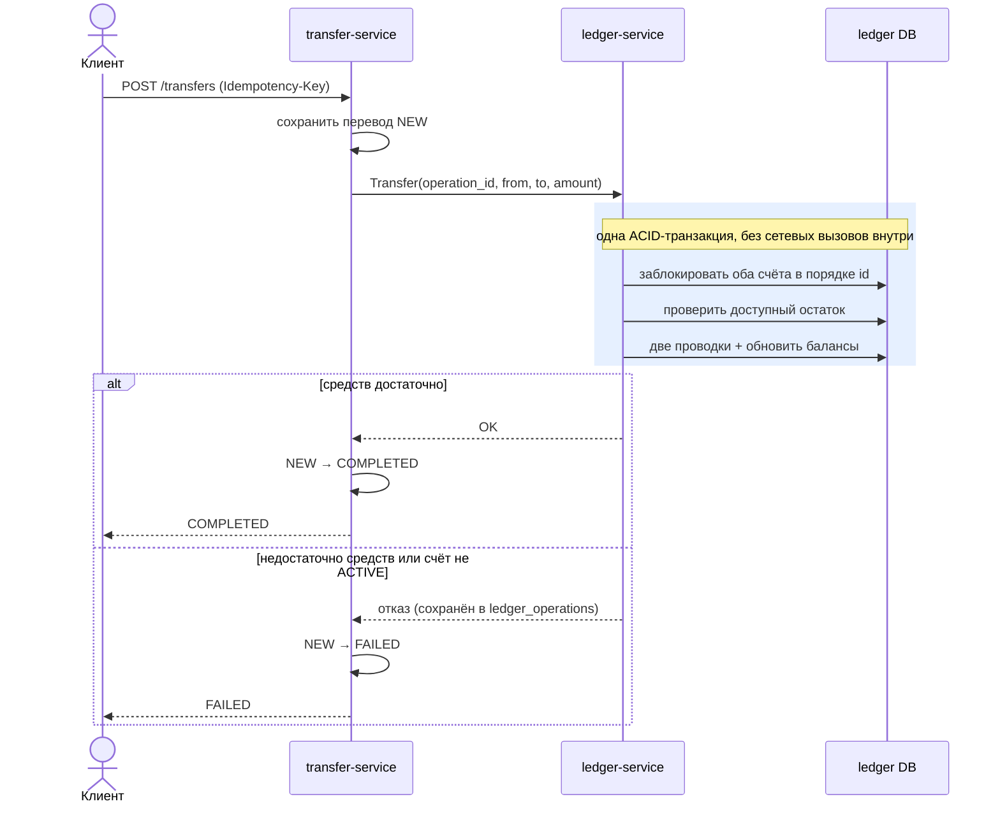
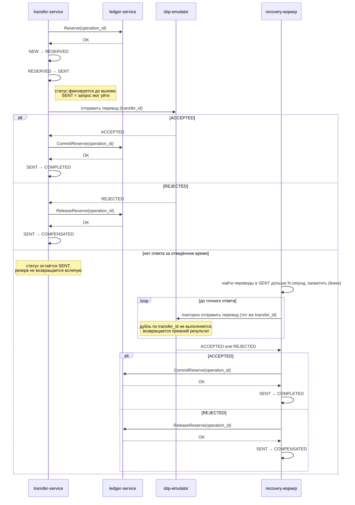

# Design doc: система переводов

> Статус: черновик

## 1. Проблема и ценность

Наивная реализация переводов теряет или задваивает деньги в типовых ситуациях:

| Сценарий | Что случится при наивной реализации | Чем закрываем |
|---|---|---|
| Клиент нажал «Перевести» дважды при плохой сети | Деньги спишутся дважды | Идемпотентность (`Idempotency-Key`, `operation_id`) |
| Два перевода с одного счёта одновременно | Оба увидят старый баланс, счёт уйдёт в минус | ACID-транзакция + блокировка строки счёта в ledger |
| Чужой банк не ответил вовремя | Вернём деньги, хотя они дошли (или наоборот) | Сага + recovery-воркер, не откатываем вслепую |
| Клиент не понимает, что с переводом | Звонок в поддержку | Статусная машина, понятный статус |

**Ценность.** Система гарантирует, что повторное нажатие не спишет деньги дважды, параллельные переводы не уведут счёт в минус, а сбой внешнего банка не приведёт к потере или задвоению денег. Клиент всегда видит статус перевода, а по каждому переводу можно восстановить, что произошло. Для банка это прямые потери, которые не случаются, и меньше обращений в поддержку.

## 2. Цели и не цели

**Цели первой версии:**
- ledger-service: счета, журнал проводок по двойной записи, перевод между счетами внутри банка, идемпотентность, тесты на конкурентность.
- transfer-service (минимально): REST API, вызов ledger, статусы для внутреннего перевода.

**Следующие итерации:** сага с sbp-emulator, recovery-воркер, outbox → Kafka → notification-service (Kotlin), наблюдаемость (метрики, трассировка, логи), шардирование ledger.

**Не цели:**
- Аутентификация и авторизация. Клиент передаётся через `client_id`. В продакшене: JWT на входе в transfer-service, проверка, что счёт списания принадлежит клиенту.
- Мультивалютность и конвертация. Одна валюта (RUB), но валюта хранится у счёта, перевод между разными валютами отклоняется.
- Дневные лимиты и антифрод.

## 3. Почему микросервисы

Под нагрузку учебного проекта хватило бы модульного монолита. Микросервисы выбраны **для обучения**, но границы проведены так, как в продакшене: по зонам ответственности и требованиям к надёжности. Подробно: [ADR-001](adr/0001-microservices.md).

## 4. Архитектура

### 4.1 Контекст

### 4.2 Сервисы

Пунктиром — компоненты следующих итераций.

| Сервис | Ответственность | Почему отдельно |
|---|---|---|
| ledger-service | Счета, балансы, проводки, резервы. **Единственный, кто меняет деньги** | Источник правды по деньгам: строгая согласованность, аудит, редкие осторожные релизы |
| transfer-service | API клиента, идемпотентность, статусы, сага | Бизнес-процесс часто меняется (новые типы переводов, лимиты) |
| notification-service | Уведомления и история по событиям из Kafka | Может отставать и падать, не влияя на деньги |
| sbp-emulator | Имитирует чужой банк: задержки, отказы, таймауты | Нужен, чтобы проверить сагу и неопределённый исход |

Каждый сервис владеет своей БД. Другие сервисы не ходят в чужую БД напрямую.

## 5. Модель данных

### 5.1 ledger DB

Модель хранения баланса: [ADR-002](adr/0002-balance-storage.md).

Инварианты модели данных:
- Двойная запись: каждая операция — минимум две проводки с общим `transfer_id`, их сумма равна 0. Следовательно, сумма всех проводок в системе равна 0: деньги не появляются и не исчезают, только перемещаются.
- Проводки неизменяемые: только добавление. Ошибочная операция исправляется сторно — обратной проводкой, история сохраняется.
- `balance` счёта всегда равен сумме его проводок и обновляется в той же транзакции, что и проводки.
- Деньги поступают в систему через системный счёт `EXTERNAL_FUNDING` (`type = SYSTEM`), которому разрешён отрицательный баланс. Клиентский счёт в минус уйти не может.
- Переводы в другие банки зачисляются на системный корреспондентский счёт `INTERBANK_SETTLEMENT`: на нём учитывается, сколько денег отправлено во внешние банки.
- Каждый резерв хранится отдельной строкой в `holds`, по одному на перевод. `Reserve` создаёт холд в статусе `ACTIVE`; `CommitReserve` и `ReleaseReserve` находят его по `transfer_id` и берут сумму из него. Переходы возможны только из `ACTIVE`, поэтому холд нельзя списать или снять дважды.
- Холд проводок не создаёт. Проводки появляются при фактическом списании (`CommitReserve`): счёт клиента → `INTERBANK_SETTLEMENT`.
- `reserved` счёта всегда равен сумме его активных холдов и обновляется в той же транзакции, что и холды.
- `ledger_operations` — журнал выполненных вызовов. Повторный вызов с тем же `operation_id` не выполняется заново, а возвращает сохранённый `result`.
- Каждая проводка ссылается на вызов, который её создал (`entries.operation_id`). Проводка не может появиться без зарегистрированного вызова, и для любой проводки видно, каким вызовом она создана. Вызовы `RESERVE` и `RELEASE_RESERVE` проводок не создают.
- Доступный остаток = `balance − reserved`. У клиентского счёта всегда `0 ≤ reserved ≤ balance`.
- Списание и зачисление возможны только для счетов в статусе `ACTIVE`.
- Запись в `ledger_operations` создаётся в той же транзакции, что и изменения денег. Фиксируются и отказы (например, недостаточно средств): повторный вызов возвращает тот же отказ, даже если за это время на счёт пришли деньги.
- Суммы хранятся как `NUMERIC(19,2)`, без чисел с плавающей точкой.

### 5.2 transfer DB

| Таблица | Назначение |
|---|---|
| `transfers` | id, счёт отправителя, получатель (для INTERNAL — наш счёт, для EXTERNAL — реквизиты в другом банке), сумма, валюта, тип (INTERNAL / EXTERNAL), статус; `locked_until` — до какого момента перевод захвачен экземпляром recovery-воркера; `lease_version` — номер захвата, защищает от записи устаревшим экземпляром |
| `idempotency_keys` | ключ клиента → id перевода и ответ; повтор запроса возвращает сохранённый ответ |
| `outbox` | события для Kafka, пишутся в той же транзакции, что и смена статуса |

## 6. Статусная машина перевода

Каждый переход — compare-and-set: `UPDATE ... WHERE id = ? AND status = ?`. Если обновилось 0 строк, переход уже сделал кто-то другой.

## 7. Сценарии

### 7.1 Перевод внутри банка

Почему в порядке id: два встречных перевода (А→Б и Б→А) иначе могут заблокировать счета в разном порядке и попасть в дедлок.

### 7.2 Перевод в другой банк (сага)

Решение сага vs 2PC: [ADR-003](adr/0003-saga-vs-2pc.md).

Ключевые правила:
- **Статус `SENT` записывается до вызова внешней системы.** Тогда каждый статус однозначен: `RESERVED` — запрос точно не отправлялся, перевод можно безопасно отменить; `SENT` — запрос мог уйти. Если записывать статус после вызова, то при сбое между вызовом и записью `RESERVED` перестанет быть однозначным, и безопасно отменить такой перевод будет нельзя.
- **Запрос во внешнюю систему идемпотентен по `transfer_id`.** Повторная отправка не создаёт второй перевод, а возвращает результат первого. Поэтому `SENT` без фактической отправки (сбой сразу после записи статуса) безопасен: recovery отправит запрос повторно.
- **Из `SENT` холд снимается (`ReleaseReserve`) только при явном отказе внешней системы (`REJECTED`).** Отсутствие ответа не считается отказом: исходный запрос может быть ещё в пути, и снятие холда приведёт к двойной выплате.

Recovery-воркер — фоновый процесс внутри transfer-service; на схеме показан отдельно для наглядности. Он обрабатывает все незавершённые статусы, а не только `SENT`: сервис может упасть на любом шаге.

| Статус зависшего перевода | Что могло произойти | Действие recovery |
|---|---|---|
| `NEW` | Вызов ledger мог выполниться, но ответ не сохранён | Повторить вызов ledger с тем же `operation_id`: ledger вернёт результат первого вызова или выполнит его сейчас |
| `RESERVED` | Холд есть, запрос в чужой банк точно не отправлялся | Продолжить сагу: `RESERVED → SENT` и отправка |
| `SENT` | Запрос мог уйти | Повторно отправить запрос с тем же `transfer_id` до точного ответа |

Это работает, потому что каждый шаг идемпотентен: повтор любого шага с теми же ключами не меняет результат.

## 8. Контракты

### REST (transfer-service, для клиента)

| Метод | Назначение |
|---|---|
| `POST /api/v1/transfers` + заголовок `Idempotency-Key` | Создать перевод. Повтор с тем же ключом возвращает тот же перевод, а не создаёт новый |
| `GET /api/v1/transfers/{id}` | Узнать статус перевода |

### gRPC (ledger-service, вызывает transfer-service)

| Метод | Что делает с деньгами |
|---|---|
| `CreateAccount` | Открывает счёт клиента с нулевым балансом |
| `Deposit` | Пополнение: проводки `EXTERNAL_FUNDING` → счёт клиента, тип `FUNDING` |
| `Transfer` | Перевод между двумя счетами банка: списание и зачисление одной транзакцией |
| `Reserve` | Холд: увеличивает `reserved`, доступный остаток уменьшается, баланс пока не меняется |
| `CommitReserve` | Списывает зарезервированную сумму (проводки) и снимает холд |
| `ReleaseReserve` | Снимает холд без списания, деньги снова доступны клиенту |
| `GetAccount` | Возвращает баланс и доступный остаток |

Каждый изменяющий метод принимает `operation_id` — ключ идемпотентности вызова. Если transfer-service не получил ответ и повторил вызов, ledger по `operation_id` поймёт, что операция уже выполнена, и вернёт прежний результат вместо повторного списания.

### Kafka

Топик `transfer-events`: события смены статуса перевода. Ключ сообщения — `transfer_id`, поэтому события одного перевода попадают в одну партицию и читаются по порядку.

## 9. Известные ограничения

- **Горячие системные счета.** Каждый внешний перевод блокирует строку `INTERBANK_SETTLEMENT`, каждое пополнение — `EXTERNAL_FUNDING`. Операции через один системный счёт выполняются последовательно, и при росте нагрузки это станет узким местом. Возможные решения: несколько субсчетов с распределением операций между ними или пакетное зачисление на системный счёт.
- **Одна валюта.** Конвертация не поддерживается.

## 10. Этапы

| # | Этап | Результат |
|---|---|---|
| 0 | Основа | Design doc, ADR, многомодульный проект, PostgreSQL в Docker, CI с тестами |
| 1 | Ledger | Счета и проводки; перевод внутри банка одной транзакцией с блокировкой счетов; повтор операции не списывает деньги дважды. Тестами доказано: параллельные списания не уводят счёт в минус, встречные переводы не попадают в дедлок |
| 2 | Transfer-service | REST API для клиента с `Idempotency-Key`; перевод получает статус и проходит путь `NEW → COMPLETED / FAILED`; ledger вызывается по gRPC; recovery доводит переводы, зависшие в `NEW` |
| 3 | Перевод в другой банк | Эмулятор чужого банка с задержками, отказами и таймаутами; сага «резерв → подтверждение или возврат»; recovery-воркер доводит переводы, по которым ответ не пришёл |
| 4 | Уведомления | События о смене статуса надёжно публикуются в Kafka (transactional outbox); notification-service на Kotlin принимает их без дублей |
| 5 | Наблюдаемость | Дашборды Grafana: переводы в секунду, доля ошибок, зависшие переводы по статусам; сквозная трассировка запроса через все сервисы; логи с `trace_id` |
| 6 | Масштабирование | Ledger на двух базах с распределением счетов по `account_id`, переводы между базами через транзитный счёт; лимиты на переводы; обработка «горячего» счёта с большим потоком операций |

## 11. Решения

- [ADR-001: Микросервисы вместо модульного монолита](adr/0001-microservices.md)
- [ADR-002: Хранение баланса](adr/0002-balance-storage.md)
- [ADR-003: Сага вместо 2PC для переводов в другой банк](adr/0003-saga-vs-2pc.md)
- [ADR-004: Доступ к данным в ledger через EntityManager и свои запросы](adr/0004-data-access-entitymanager.md)
